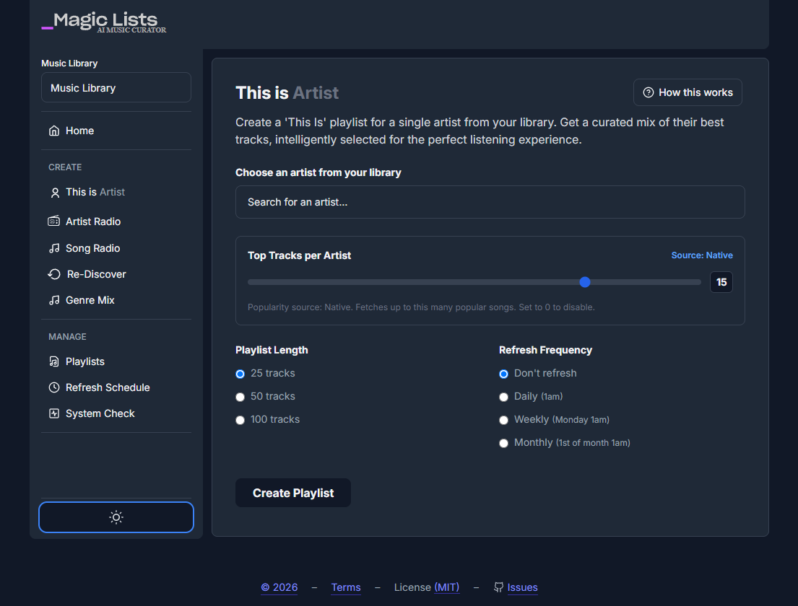
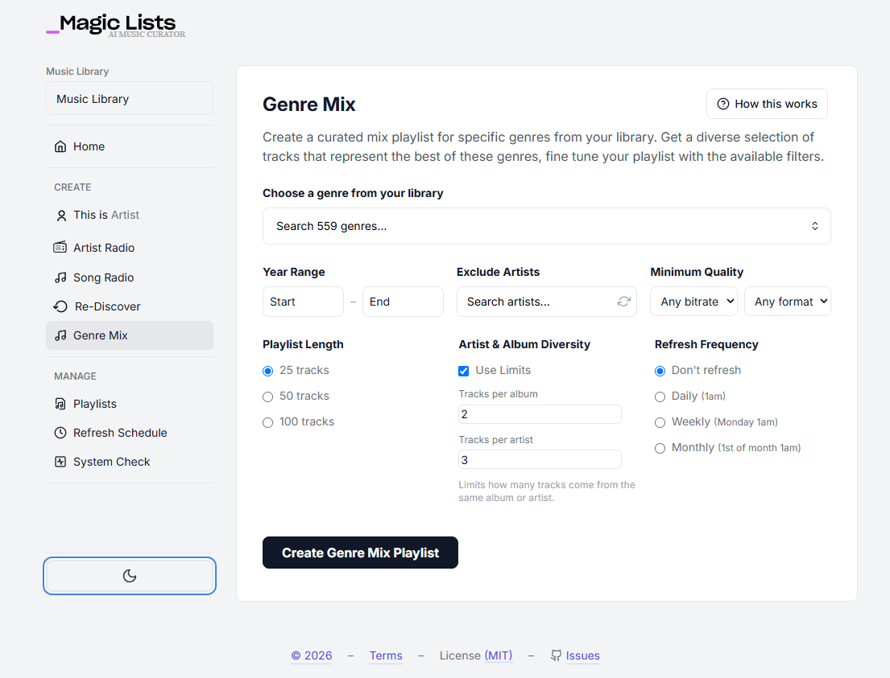

# MagicLists AI Curator

**AI-assisted playlists for your own music library.**

MagicLists adds the kind of curated, evolving playlists you’d expect from Spotify or Apple Music—except it works entirely on your self-hosted Navidrome or Jellyfin server. No subscriptions, no renting your music back. Just smart mixes generated from the library you already own.

## What it does

Five playlist types, automatic refresh, and a UI that stays out of your way. Each one has a
full description in **[docs/FEATURES.md](docs/FEATURES.md)**.

| Feature | What it gives you |
|---|---|
| 🎵 **[This Is (Artist)](docs/FEATURES.md#this-is-artist)** | A definitive playlist for one artist — hits, deep cuts, and guest appearances, without duplicates. |
| 📻 **[Artist Radio](docs/FEATURES.md#artist-radio)** | A mix built from an artist plus similar artists, so you can explore without knowing the names. |
| 🎧 **[Song Radio](docs/FEATURES.md#song-radio)** | A radio built around a single track, with a preview of the candidate pool before you commit. |
| 🎸 **[Genre Mix](docs/FEATURES.md#genre-mix)** | A playlist from whole genres, with year, quality, and per-album/per-artist filters. |
| 🔄 **[Re-Discover](docs/FEATURES.md#re-discover)** | Tracks you haven't played in a while, so your collection keeps surprising you. |
| ⏰ **[Refresh scheduling](docs/FEATURES.md#-refresh-scheduling)** | Per-playlist schedules, a Refresh Schedule page with history, and refreshes queued one at a time so your AI provider never gets rate limited. |
| 🎧 **[Artist top tracks](docs/FEATURES.md#-artist-top-tracks)** | Popular songs per artist — native on Navidrome, via Last.fm on Jellyfin. |
| 🖥️ **[Navidrome & Jellyfin](docs/FEATURES.md#-works-with-navidrome-and-jellyfin)** | Works with either server, each with its own database. |
| 📚 **[Multiple libraries](docs/FEATURES.md#-multiple-libraries)** | Pick which library to work with; your choice is remembered. |
| ✏️ **[Playlist editing](docs/FEATURES.md#-playlist-editing)** | Rename, re-describe, change length, filters, or schedule — then save, or save and rebuild in one click. |
| 🌙 **[Dark mode](docs/FEATURES.md#-dark-mode)** | A proper light and dark theme across the whole app. |
| 🩺 **[System check](docs/FEATURES.md#-system-check)** | Validates your configuration on startup and tells you exactly what to fix. |
| ⚡ **[No library scans](docs/FEATURES.md#-no-library-scans)** | Playlist building uses your server's existing library metadata — no full library scans, so there is no wasted waiting time. |

👉 **[See all features, including everything new →](docs/FEATURES.md)**

## Why it matters
Navidrome and Jellyfin users already own their music. MagicLists brings modern curation tools into that world—so your playlists feel alive, not static, and your collection keeps surprising you.

## What's that Fork?
This repo is a fork of Ricky Synnot's [magic-lists-for-navidrome](https://github.com/rsynnot/magic-lists-for-navidrome).  
It is an improved version with many bug fixes and more features, including, e.g., Jellyfin implementation, artist radio, song radio, genre mix with advanced filters, dark mode, no usage tracking and many more features...


## Screenshots


_Creating a 'This is (Artist)' playlist_ 



_Creating a 'Genre Mix' playlist_ 

### Other Screenshots:

#### [Artist Radio UI](assets/images/artist-radio.png)

#### [Song Radio UI](assets/images/song-radio.png)


## What’s still a work in progress?
### Some features are still barely or not at all tested, including:
 - Jellyfin Server Client
   - Artist Radio Similarity Check
   - Song Radio Similarity Check
   - Playlist Generation Quality
   - Support for Big Music Libraries
   - LastFm top tracks fetching
 - Song Radio
   - ListenBrainz Similarity Check
   - Playlist Generation Quality

Please contribute to the project and report your testing and experience with this application on the Issues or Discussions tab.

## What’s next
Upcoming versions include:
- More playlist types and improved curation.
- Support for more Self-Hosted Music Servers.
- Improved Documentation and Tutorials.
- What is on your mind? Open an issue to tell me.


# 📖 Documentation Index

All setup and troubleshooting instructions now live in the [`docs/`](docs/) folder. Pick the path that matches your setup and jump straight to it.

## 🚀 Installation

| I want to… | Guide |
|---|---|
| **Add MagicLists to my existing Docker Compose (recommended)** | **[`docs/DOCKER.md`](docs/DOCKER.md)** |
| Run a standalone container with `docker run` | **[`docs/DOCKER.md` → Standalone Docker Run](docs/DOCKER.md#standalone-docker-run)** |
| Compare install methods / not sure where to start | **[`docs/INSTALLATION.md`](docs/INSTALLATION.md)** |
| Develop or contribute from source | **[`docs/RUNNING_LOCALLY.md`](docs/RUNNING_LOCALLY.md)** |

> **Recommended: Docker Compose.** Your MagicLists container joins the **same network** as Navidrome/Jellyfin, so the connection is simple and reliable — no host ports, no `host.docker.internal`. It's also the only setup that unlocks future features needing local file access, such as audio analysis, and a single-service compose file doubles as a clean standalone stack.

## 🎵 Server Setup

| My server | Guide |
|---|---|
| **Navidrome** | **[`docs/NAVIDROME.md`](docs/NAVIDROME.md)** |
| **Jellyfin** | **[`docs/JELLYFIN.md`](docs/JELLYFIN.md)** |

## 🤖 AI Configuration

| I want to… | Guide |
|---|---|
| **Choose an AI provider (start here)** | **[`docs/AI_PROVIDERS.md`](docs/AI_PROVIDERS.md)** |
| ⭐ **Recommended setup** | Google AI Studio — `AI_PROVIDER=google`, `AI_MODEL=gemini-3.1-flash-lite`, `DESCRIPTION_AI_MODEL=gemma-4-26b-a4b-it` |
| Run fully local & private | [Ollama](docs/AI_PROVIDERS.md#option-2--local-llm-ollama) |
| Use a different cloud provider | [OpenRouter](docs/AI_PROVIDERS.md#option-4--openrouter) · [Groq](docs/AI_PROVIDERS.md#option-5--groq) |

> **Why Google?** The free tier is generous, **no credit card is required**, and one API key is all you need. `gemini-3.1-flash-lite` is fast and handles large track lists comfortably; `gemma-4-26b-a4b-it` is small and quick, used only for playlist descriptions.

## 🔧 Reference & Help

| I need… | Guide |
|---|---|
| **See everything the app can do** | **[`docs/FEATURES.md`](docs/FEATURES.md)** |
| Look up an environment variable | **[`docs/ENVIRONMENT.md`](docs/ENVIRONMENT.md)** |
| Fix something that isn't working | **[`docs/TROUBLESHOOTING.md`](docs/TROUBLESHOOTING.md)** |
| Tune the AI prompt recipes | **[`recipes/README.md`](recipes/README.md)** |
| Use the REST API | **[`docs/API.md`](docs/API.md)** |

## ⚡ The 60-second version (Docker Compose)

```yaml
services:
  magiclists:
    image: pirus999/magic-lists-ai-curator:latest
    container_name: magiclists
    ports:
      - "4545:8000"
    environment:
      - SERVER_TYPE=navidrome                  # or: jellyfin
      - NAVIDROME_URL=http://navidrome:4533   # Jellyfin: JELLYFIN_URL=http://jellyfin:8096
      - NAVIDROME_USERNAME=your_username       # Jellyfin: JELLYFIN_USERNAME or JELLYFIN_API_KEY
      - NAVIDROME_PASSWORD=your_password       # Jellyfin: JELLYFIN_PASSWORD or JELLYFIN_API_KEY
      - DATABASE_PATH=/app/data/magiclists.db # Required: database location
      - AI_PROVIDER=google                     # openrouter, groq, google, ollama
      - AI_API_KEY=your_google_api_key
      - AI_MODEL=gemini-3.1-flash-lite
      - DESCRIPTION_AI_MODEL=gemma-4-26b-a4b-it
      - LASTFM_API_KEY=your_lastfm_key        # Optional: Jellyfin top tracks via Last.fm
    volumes:
      - ./magiclists-data:/app/data           # Persist database + settings
    restart: unless-stopped
```

```bash
mkdir -p magiclists-data
docker compose up -d
```

Then open **http://localhost:4545** and verify everything at **http://localhost:4545/system-check**.

👉 Full instructions: **[`docs/DOCKER.md`](docs/DOCKER.md)**

## API

MagicLists exposes a REST API for all playlist features. FastAPI also serves interactive documentation at `/docs` (Swagger UI) and `/redoc` once the app is running.

📖 **See the full [API Reference](docs/API.md)** for every endpoint, with all query parameters, request body fields, defaults, and validation rules.


## License

MIT License - see LICENSE file for details.

## Contributing

1. Fork the repository
2. Create a feature branch
3. Make your changes
4. Add tests if applicable
5. Submit a pull request

## 📈 Usage Analytics

This fork of the Project currently does not use any usage analytics.

## Support

For issues and questions:
- Run the built-in check at `http://localhost:4545/system-check`
- Check the [troubleshooting guide](docs/TROUBLESHOOTING.md)
- Look up your variables in the [environment reference](docs/ENVIRONMENT.md)
- Review Navidrome or Jellyfin documentation
- Create an issue in the repository

## Legal Disclaimer

**No Warranty**: This software is provided "as is" without warranty of any kind, express or implied.

**User Responsibility**: You are solely responsible for:
- Ensuring you have proper rights to any music content processed through this application
- Any data transmitted to third-party AI services
- Backup of your music library before use
- Any modifications made to your playlists or library

**Limitation of Liability**: The developers shall not be liable for any damages including but not limited to data loss, corruption of music libraries, or any other direct or indirect damages arising from use of this software.

**Third-party Services**: This application integrates with external AI services. Your use of these services is subject to their respective terms of service.

By using this software, you acknowledge and accept these terms. 

---

© 2026 Miles Pickull — Licensed under the MIT License.